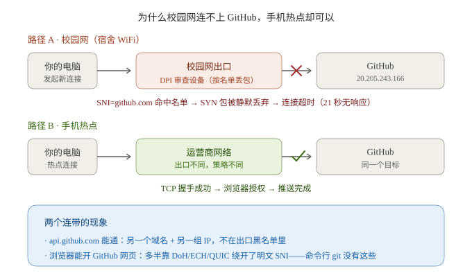

# 校园网环境下的 Git 使用生存指南

> 面向在大学校园网（宿舍 WiFi / 教育网）下使用 Git + GitHub 的学生开发者。
> 文中所有现象与结论均来自 2026-10 一次真实故障的逐层实测排查（含诊断数据与修复验证），非泛泛而谈。

## TL;DR

- **校园网连不上 GitHub ≠ 你的 git 坏了**。故障只有四类：DNS 污染、TCP 封锁、本机代理配置残留、服务端/基础断网——30 秒就能定位是哪类。
- **「校园网加速器」对封锁无效**：它管快慢，不管通断。
- 最快的解法永远是：**手机热点** 或 **本地代理客户端**（Clash 等）。
- 配套只读诊断脚本：[`diagnose_net.ps1`](diagnose_net.ps1)——本文所有判读逻辑已脚本化，跑一下直接出结论。

## 目录

1. [现象对号入座](#一现象对号入座)
2. [30 秒诊断三件套](#二30-秒诊断三件套)
3. [原理：你的包死在哪一跳](#三原理你的包死在哪一跳)
4. [对症下药：六种方案](#四对症下药六种方案)
5. [Git 层面的减灾技巧](#五git-层面的减灾技巧)
6. [常见坑](#六常见坑前两个今天真实踩到)
7. [真实案例完整复盘](#七真实案例完整复盘2026-10-17)
8. [诊断脚本](#八诊断脚本)

## 一、现象对号入座

| 现象 | 最可能的根因 | 对应方案 |
| --- | --- | --- |
| 浏览器能开 GitHub 网页，命令行 git 连不上 | DNS 分裂（浏览器 DoH vs 系统 DNS），或浏览器 ECH/QUIC 绕过了明文 SNI | 先诊断，再走方案 1/2 |
| `nslookup` 解析出非 GitHub 段的奇怪 IP | DNS 污染 | 方案 3 |
| 解析正常，但 TCP 连接超时（十几秒无响应） | IP/SNI 级封锁（静默丢包） | 方案 1/2 |
| 立刻报 `Connection refused` / `reset` | 端口级主动阻断 | 方案 1/2 |
| 能通，但 clone/push 极慢 | 带宽限速（不是封锁） | 减灾技巧 |
| 时好时坏，过几天自己好了 | 时段性封锁波动 | 方案 6 |

## 二、30 秒诊断三件套

在 Git Bash 或任意终端执行：

```bash
nslookup github.com
curl -sS -m 10 -o /dev/null -w "api.github.com: %{http_code}\n" https://api.github.com
curl -sS -m 10 -o /dev/null -w "github.com: %{http_code}\n" https://github.com
```

判读表：

| 观察点 | 正常表现 | 异常含义 |
| --- | --- | --- |
| `nslookup` 的 IP | `140.82.x.x` / `20.205.x.x` 等 GitHub 真实段（权威清单：`https://api.github.com/meta`） | 奇怪 IP = DNS 污染 |
| `api.github.com` | `200` | 非 200 = 整体断网，或校园网 Portal 认证过期 |
| `github.com` | `200` | 超时 = IP/SNI 封锁；refused = 主动阻断 |
| api 通 + 主站不通 | —— | 域名/IP 级精确封锁（校园网最常见形态） |

再查两个本机配置（很多"网络问题"其实是自己配的代理在作怪）：

```bash
git config --global --get http.proxy
git config --global --get https.proxy
```

有输出 = git 正在走代理。**代理客户端没开的话，这就是元凶**：要么把客户端开起来，要么取消配置。

## 三、原理：你的包死在哪一跳



以一次真实超时为例（2026-10-17，吉首大学宿舍网实测数据）：

- DNS 正常：`github.com → 20.205.243.166`（GitHub 新加坡节点，无污染）
- `api.github.com` → HTTP **200**（通）
- `github.com` → TCP 握手 **21 秒无响应**（超时）

三层解释：

**1. 为什么是"超时"而不是"拒绝"？**

审查设备有两种手法：回 RST 包（客户端立刻报 `Connection reset`），或者**静默丢包**（SYN 石沉大海，客户端一直等到自己超时）。静默丢包更常见——因为它让你分不清"被墙了"还是"网络卡了"。

**2. 为什么 api.github.com 能通，github.com 不能？**

封锁按「域名 + IP」名单精确执行。GitHub 的 API 域名和主站是不同的域名、不同的 IP——不在名单里就放行。所以才会出现"api 返回 200、主站握手超时"的分裂现象。

**3. 为什么浏览器能开网页，命令行 git 连不上？**

最可能的解释是浏览器用上了三项新特性，绕过了明文 SNI：

- **DoH**（DNS over HTTPS）：加密 DNS 查询，绕开 DNS 污染
- **ECH**（Encrypted Client Hello）：把 TLS 握手里的域名加密，审查设备看不到你要连谁
- **QUIC**（HTTP/3 over UDP 443）：如果封锁只覆盖 TCP，QUIC 就能过

而命令行 git 一项都没有：明文 DNS + 明文 SNI + 纯 TCP，在审查设备面前一览无余。

**4. 为什么「校园网加速器」没用？**

加速器优化的是**快慢**（带宽调度、路由选择），解决不了**通断**（丢包、名单拦截）。你被丢的包不是"走慢了"，是在出口被直接丢弃——加速器既不换出口，也不加密 SNI。而且很多校园加速只对教育网内资源生效。

## 四、对症下药：六种方案

### 方案 1 · 手机热点（最快，推荐指数 ★★★★★）

电脑连手机热点 → 重试。运营商出口对 GitHub 的策略与校园网完全不同，实测 30 秒解决问题。副作用是费流量，适合"现在就要推"的场景。

### 方案 2 · 本地代理（推荐指数 ★★★★☆）

前提：本机有可用代理客户端（如 Clash，混合端口常见 7890/7897）。**先确认客户端在运行**，再配置：

```bash
git config --global http.proxy http://127.0.0.1:7897
git config --global https.proxy http://127.0.0.1:7897
```

取消（代理客户端不开的时候必须取消，否则 git 全挂）：

```bash
git config --global --unset http.proxy
git config --global --unset https.proxy
```

**双向坑**：配了代理但客户端没开 → 必挂；客户端开着但 git 没配 → git 不走代理照样被墙。诊断脚本会检查这一项。

### 方案 3 · 修改 hosts（只对 DNS 污染有效）

如果诊断显示"解析出奇怪 IP"（DNS 污染），可以手工绑定真实 IP：

1. 查真实 IP：`https://api.github.com/meta`（GitHub 官方 IP 段清单）
2. 用管理员权限编辑 `C:\Windows\System32\drivers\etc\hosts`，添加一行：

   ```text
   140.82.121.4    github.com
   ```

3. 执行 `ipconfig /flushdns` 刷新 DNS 缓存

**局限**：如果你的问题像本文案例一样是 TCP 级封锁（DNS 正常、握手超时），改 hosts **完全无效**。

### 方案 4 · SSH over 443（HTTPS 被封时的替代通道）

GitHub 官方支持把 SSH 协议走 443 端口，且 `ssh.github.com` 的 IP 与主站不同——有时主站被封它还活着：

1. 生成密钥并添加到 GitHub（Settings → SSH and GPG keys）
2. 编辑 `~/.ssh/config`：

   ```text
   Host github.com
     HostName ssh.github.com
     Port 443
     User git
   ```

3. 仓库 remote 改用 SSH 形式：`git@github.com:user/repo.git`

前提自测：`ssh -T git@ssh.github.com -p 443` 能通。

### 方案 5 · GitHub Desktop（网络栈不同）

GitHub Desktop 用自己的 HTTP 栈，有时命令行不通它能通。实测在校园网成功推送过。注意：**Desktop 的登录令牌与命令行 git 的凭据管理器不互通**——用 Desktop 推完后，命令行第一次 push 仍会弹一次授权，完成一次即永久生效。

### 方案 6 · 镜像与等待

- **Gitee 导入镜像**：把 GitHub 仓库导入 Gitee，clone 走国内线路
- **第三方加速前缀**（ghproxy 类）：仅建议用于 clone 公开仓库，**不要经第三方代理 push**（代码完整性与凭据安全风险）
- **时段性封锁**：过几天自己就好。校园网对 GitHub 的可达性波动很大，别死磕，先干别的

## 五、Git 层面的减灾技巧

- **浅克隆**：`git clone --depth 1` 只拉最近一次提交，数据量小一个数量级；之后需要历史时 `git fetch --unshallow` 补全
- **断点续传**：clone 半路失败别删目录，`cd` 进去后 `git fetch` 可以续上
- **大文件走 LFS**：模型、数据集、视频用 Git LFS，别直接塞仓库——几百 MB 的普通 blob 在校园网推送基本必死
- **凭据一次搞定**：第一次 push 弹出的 GitHub 授权窗口，在浏览器完成一次即永久生效（存于 Windows 凭据管理器），之后命令行推送不再弹窗

## 六、常见坑（前两个今天真实踩到）

1. **Git Bash 多行粘贴污染**：整块粘贴多行命令时，bracketed paste 转义序列（`^[[200~`）会粘在第一条命令上，导致 `command not found`，后面的命令全在错误目录里执行。解决：一行一行贴，或先执行 `bind 'set enable-bracketed-paste off'`
2. **GitHub Desktop 与 git CLI 凭据不互通**：Desktop 推送成功 ≠ 命令行有凭据（Desktop 的 OAuth 令牌存在自己的加密存储里）。命令行第一次 push 仍要授权一次
3. **代理配置残留**：换网络环境后忘了清 git 代理配置，表现为"在家能连、到学校连不上"或反向。换环境先查 `git config --global --get http.proxy`
4. **Portal 认证过期**：校园网要网页登录认证，过期后所有外网都不通——先随便开个网页确认基础网络，再排查 GitHub
5. **安全软件拦 git**：个别管家类软件会代理/拦截 HTTPS，表现为证书报错（`SSL certificate problem`）。排查法：暂时关闭安全软件重试

## 七、真实案例完整复盘（2026-10-17）

时间线：

1. **现象**：浏览器能打开 GitHub 并新建仓库，`git push` 报 `Failed to connect to github.com:443 after 21079 ms: Could not connect to server`
2. **诊断三件套**：
   - `nslookup github.com` → `20.205.243.166`（真实 GitHub IP，DNS 无污染；DNS 服务器为校园网 `210.43.64.10`）
   - `curl api.github.com` → **200**
   - `curl github.com` → **超时**
3. **判读**：api 域名通 + 主站域名不通 + DNS 正常 ⇒ **出口对 github.com 做 TCP 级封锁（静默丢包）**，与 DNS、本机 git 配置、凭据全部无关
4. **验证推断**：切换手机热点 → `curl github.com` 立刻 `200` → push 一次成功
5. **结论**：换出口（热点）是最优解；加速器无效

同日两个独立故障，供对照参考：

- WorkBuddy 电脑端"僵死在线"（手机端显示电脑离线、电脑端一切正常）→ 完整退出重开解决，与网络无关——见[另一个仓库](https://github.com/csue123123-rgb/workbuddy-mobile-offline-fix)
- 部分执行环境的沙箱代理同样无法访问 github.com——**连别的机器都连不上时，就更不是你的问题了**

## 八、诊断脚本

```powershell
powershell -ExecutionPolicy Bypass -File diagnose_net.ps1
```

只读检查五项：git 代理配置残留、hosts 覆写、DNS 解析真伪、api/主站连通性对比、TCP 握手，并按本文判读表自动输出结论。不改任何系统设置，源码可读。

## License

MIT
